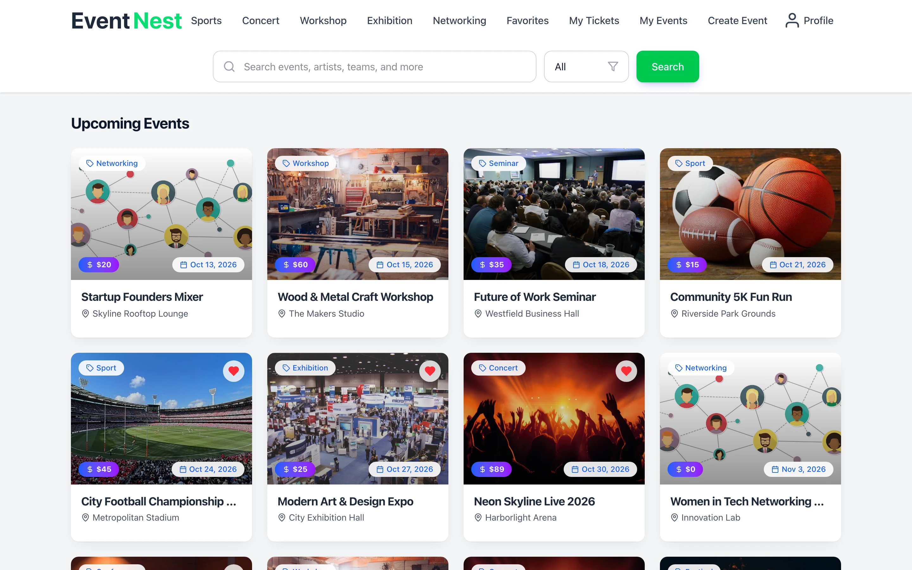
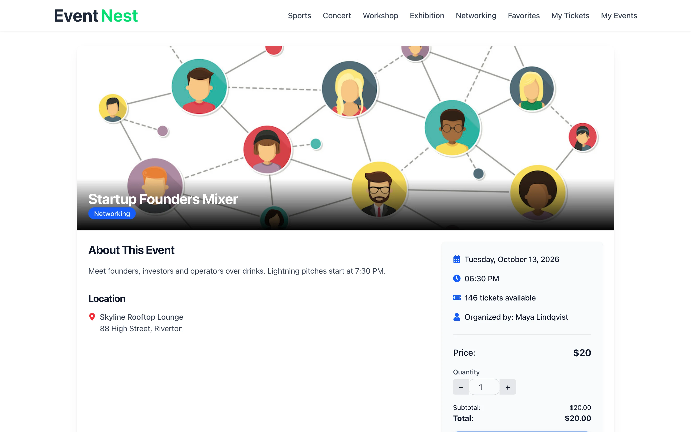
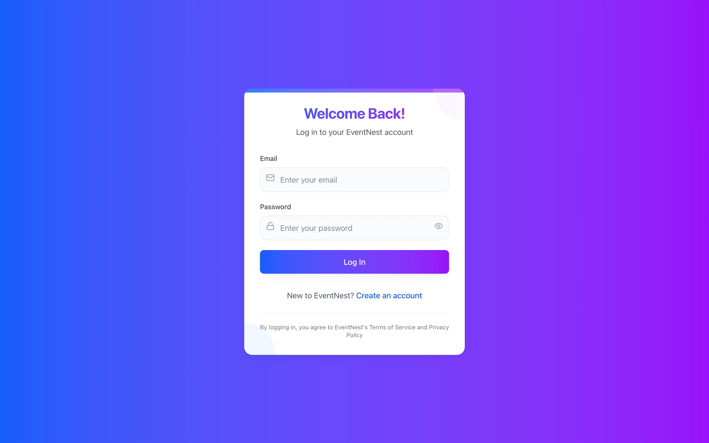
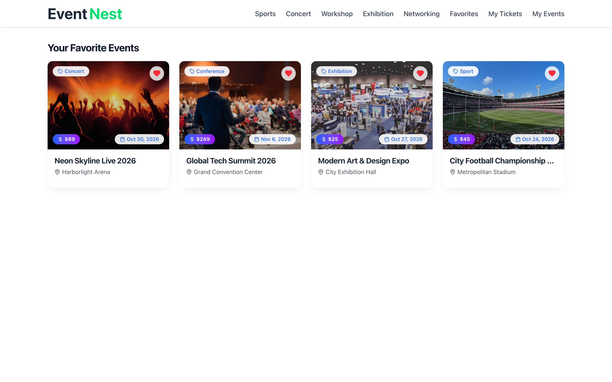
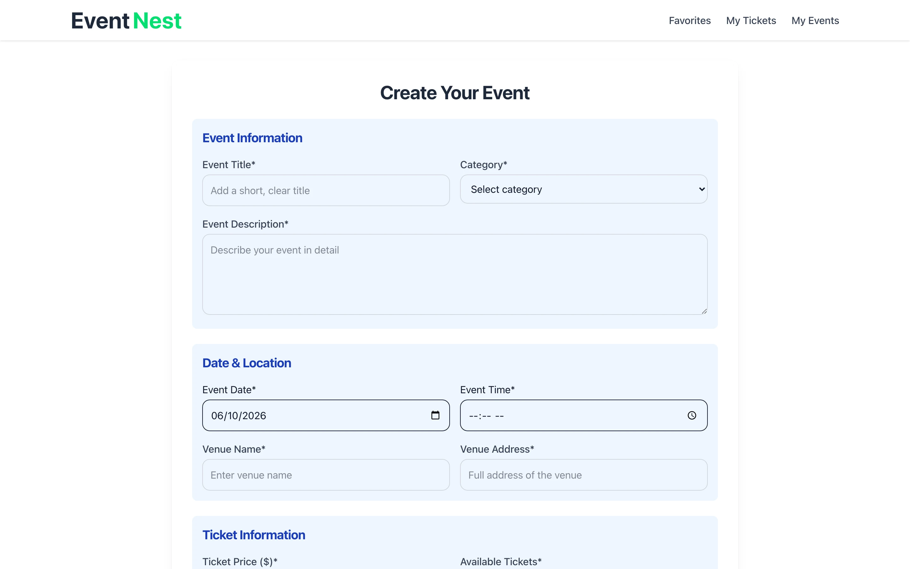
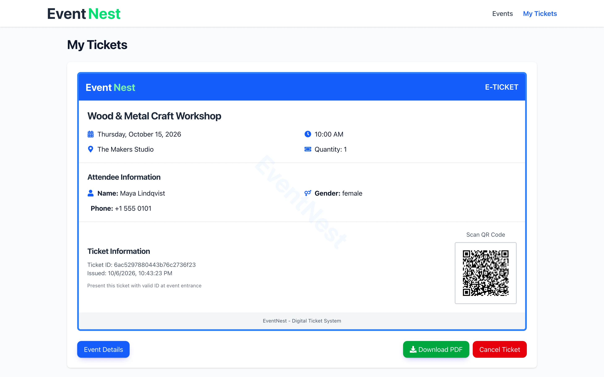
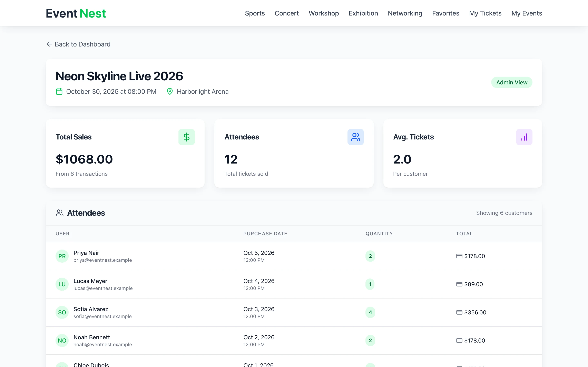
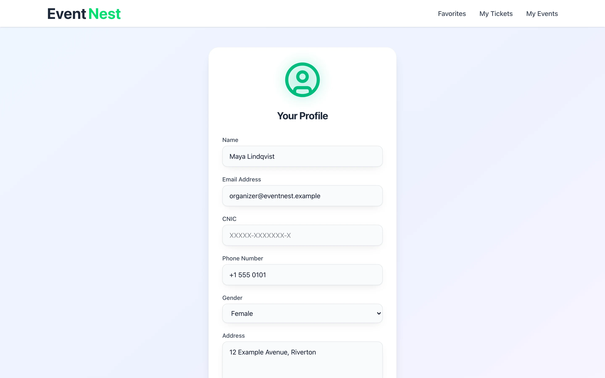

# Event-Nest

**A full-stack event ticket booking platform: browse and search events by category, purchase tickets via Stripe Checkout, receive QR e-tickets, and for organizers, manage events and view sales analytics.**

**Web · Full-stack** React 18 · Vite 6 · Tailwind 4 · Node.js · Express 5 · MongoDB · Stripe

<table>
  <tr>
    <td></td>
    <td></td>
  </tr>
</table>

Screenshots are real captures of a local build running on fictional demo data.

---

## Product at a Glance

| | |
|---|---|
| **What it is** | Event discovery and ticketing: attendees search/filter/favorite events and buy tickets; organizers create events with media and view sales. |
| **Platforms** | Web (React SPA + Express REST API); runs locally or deployable to any Node.js host |
| **Authentication** | JWT (jsonwebtoken) with bcrypt password hashing; stateless bearer tokens |
| **Ticketing** | Real-time inventory tracking, Stripe Checkout payment, per-booking QR e-tickets (printable PDF) |
| **Media** | Multi-file image/video uploads via multer; stored locally; production would use S3/CDN |
| **Search** | Full-text search by event name and category filtering (sports, concerts, workshops, networking, exhibitions) |
| **Organizer Tools** | Event CRUD, dashboard with revenue, attendee count, and per-event metrics |
| **Database** | MongoDB with user, event, ticket, and favorites collections |
| **Routes** | 17 pages: auth, event discovery, category feeds, search, checkout, e-tickets, favorites, my events, organizer admin, profile |

## Product Showcase

<table>
  <tr>
    <td align="center"> <b>Login</b> JWT auth</td>
    <td align="center"> <b>Favorites</b> Saved events</td>
    <td align="center"> <b>Create Event</b> Organizer form</td>
    <td align="center"> <b>My Tickets</b> QR + PDF export</td>
  </tr>
  <tr>
    <td align="center"> <b>Organizer Admin</b> Sales and attendees</td>
    <td align="center"> <b>Profile</b> Account settings</td>
  </tr>
</table>

## Key Features

- **Event Discovery.** Browse categories, full-text search, favorite events for later.
- **Ticketing.** Real-time inventory; book via Stripe Checkout; cancel anytime to restore stock.
- **E-Tickets.** QR code generation (data URL embedded in PDF); printable or scan on-screen.
- **Media Upload.** Organizers upload cover images and video previews; multer validates file type and size.
- **Organizer Dashboard.** Revenue totals, attendee list, per-event metrics, and event edit interface.
- **Responsive UI.** Mobile-first design with Tailwind CSS; Framer Motion transitions.

## Architecture

Stateless REST API with JWT bearer tokens. React SPA calls `/event`, `/ticket`, `/user`, and `/payment` endpoints. Stripe Checkout is hosted; webhooks verify payment and trigger ticket issuance. Inventory is transactional: MongoDB sessions wrap decrement on purchase and restore on cancel. Event media is stored locally; production deployment moves to a CDN.

Details: [docs/ARCHITECTURE.md](docs/ARCHITECTURE.md)

## Engineering Highlights

- **End-to-end payment threading.** Stripe Checkout session is stored temporarily; webhook verifies signature and amount before creating tickets. Avoids orphaned bookings.
- **Inventory atomicity.** MongoDB transactions wrap ticket creation and inventory decrement; cancellation restores stock.
- **Organizer authorization.** Event edit and ticket data endpoints verify both organizer flag and event ownership.
- **QR e-tickets.** Generated client-side as data URLs; no server-side PDF rendering. Printable via browser.
- **Multi-file uploads.** Multer middleware handles image/video validation (MIME type, file size); stored locally in demo; production uses S3.
- **Stateless auth.** JWT tokens in bearer header; no session database required.

More: [docs/ENGINEERING_CHALLENGES.md](docs/ENGINEERING_CHALLENGES.md)

## Status & Scope

This is a portfolio build running in demo mode with seeded fictional data. The platform demonstrates real functionality: attendees can browse, search, favorite, and purchase tickets; organizers can create events, edit details, and view sales. 

**Known Limitations & Roadmap:**

- **Stripe Checkout.** Offline demo cannot demonstrate live payment. Requires valid Stripe account keys (not included in this repository).
- **Session Storage.** Stripe checkout sessions are stored in-memory; production upgrades to Redis with 15-minute TTL and expiry cleanup.
- **Event Delete Authorization.** Missing ownership check; any organizer can delete any event. Fix recommended in docs.
- **Organizer Dashboard Metric.** "Tickets Sold" field reads a non-existent field (always 0); real value would sum ticket quantities.
- **Node 26 Compatibility.** SlowBuffer removed in Node 26; build includes shim (analysis/demo-seed/slowbuffer-shim.js) to restore compatibility.
- **Testing.** No test suite; manual testing during development. Production deployment requires unit, integration, and e2e coverage.
- **File Storage.** Local uploads in `/backend/uploads/`; production should use S3 or CDN.
- **Search Indexing.** Regex-based text search is slow on large datasets; production should add MongoDB text indexes or Elasticsearch.

## Documentation

| Read | For |
|---|---|
| [Technical case study](docs/TECHNICAL_CASE_STUDY.md) | Payment flow, QR generation, inventory accounting, upload strategy |
| [Architecture](docs/ARCHITECTURE.md) | System design, data model, API endpoints, security |
| [Engineering challenges](docs/ENGINEERING_CHALLENGES.md) | Design decisions, production roadmap, known limitations |
| [Product overview](docs/PRODUCT_OVERVIEW.md) | User roles, features, technical choices |
| [Privacy and source](docs/PRIVACY_AND_SOURCE.md) | What is published, license terms |

## Source Code

This repository is a portfolio showcase for a production application. Production source code is maintained privately. See [RIGHTS.md](RIGHTS.md) for usage terms.
