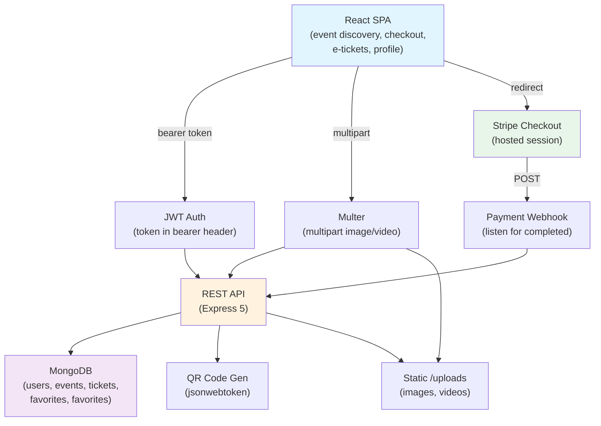

# Architecture

All diagrams are original and conceptual.

## System Overview

## Request Flow: Ticket Purchase

1. **Browse & Checkout:** Attendee selects event and quantity on detail page
2. **Stripe Session:** Backend creates session (event id, user id, quantity) and returns client ID
3. **Payment:** User completes payment on Stripe's hosted checkout
4. **Webhook:** Stripe POSTs payment completion; backend verifies and creates ticket record
5. **Confirmation:** Frontend redirects to success page, shows QR code and PDF download option
6. **Cancellation:** Attendee cancels via my-tickets; inventory restored, ticket marked cancelled

## Data Model

- **Users:** id, email, password (bcrypt), organizer flag, profile fields
- **Events:** id, title, description, organizer id, category, price, inventory (count), media urls
- **Tickets:** id, event id, user id, quantity, qr code (data URL), created at, cancelled flag
- **Favorites:** user id, event id (join table)
- **Stripe Sessions:** session id, event id, user id, quantity (stored for webhook matching)

## API Endpoints

**User Routes:**
- POST /user/register (email, password)
- POST /user/login (email, password) → token
- GET /user/profile (auth required)
- PATCH /user/profile (auth required)
- GET /user/organizer-status

**Event Routes:**
- POST /event (organizer; multipart)
- GET /event/:id
- PATCH /event/:id (organizer; multipart)
- DELETE /event/:id (organizer; **missing check**)
- GET /event/search?q=text&category=sports
- GET /event/all

**Ticket Routes:**
- POST /ticket (after payment webhook)
- GET /ticket/my-tickets (auth required)
- DELETE /ticket/:id (cancel)
- GET /ticket/event/:id (organizer-only)

**Stripe Routes:**
- POST /payment/checkout-session
- POST /payment/webhook (Stripe signature verify)

**Favorites Routes:**
- POST /favourite (auth required)
- DELETE /favourite/:eventId (auth required)
- GET /favourite (auth required)

## Security & Authorization

- JWT tokens issued on login; expiration checked on protected routes
- Organizer routes verify user.organizer flag and event ownership
- Stripe webhook verifies signature (hmac-sha256)
- Inventory decremented on ticket creation; restored on cancellation
- No delete permission check on events (vulnerability; organizer access only via code review)

## File Storage

Images and videos uploaded via multipart go to `/backend/uploads/images/` and `/backend/uploads/videos/`. Frontend serves via static route; no CDN in this build. Demo seeded with stock images copied to this directory.
